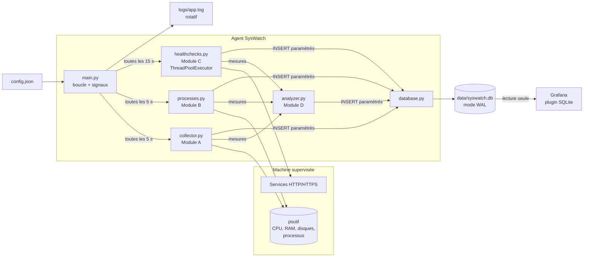
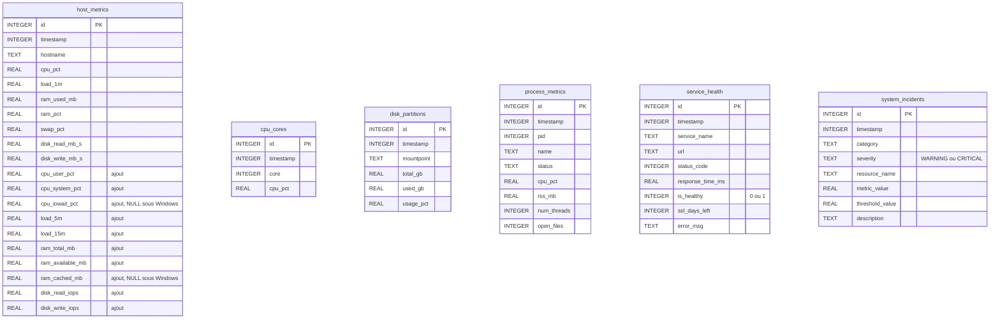

# SysWatch-API — Agent de supervision système, processus et santé applicative

SysWatch-API est un agent écrit en Python qui surveille en continu une machine
(Windows ou Linux) et enregistre ses mesures dans une base SQLite affichée
dans Grafana :

- **Module A — Système** : CPU (global, par cœur, user/system/iowait),
  charge moyenne, mémoire, swap, occupation des partitions, débits et IOPS
  disque.
- **Module B — Processus** : processus surveillés (liste de motifs) et top 5
  des processus les plus gourmands en CPU et en RAM.
- **Module C — Santé applicative** : tests HTTP/HTTPS en parallèle (code
  retour, temps de réponse, clé JSON attendue, jours restants avant
  l'expiration du certificat).
- **Module D — Seuils et SLA** : taux de disponibilité de chaque service et
  incidents (disque plein, fuite mémoire, certificat bientôt expiré, service
  en panne, SLA sous l'objectif).

---

## Sommaire

1. [Architecture logicielle](#1-architecture-logicielle)
2. [Modèle de données SQLite](#2-modèle-de-données-sqlite)
3. [Les étapes du projet, expliquées](#3-les-étapes-du-projet-expliquées)
4. [Installation et lancement (Python)](#4-installation-et-lancement-python)
5. [Installation de Grafana et du tableau de bord](#5-installation-de-grafana-et-du-tableau-de-bord)
6. [Tests et qualité du code](#6-tests-et-qualité-du-code)
7. [Configuration (config.json)](#7-configuration-configjson)
8. [Choix techniques justifiés](#8-choix-techniques-justifiés)
9. [Limites identifiées](#9-limites-identifiées)
10. [Requêtes SQL du tableau de bord](#10-requêtes-sql-du-tableau-de-bord)

---

## 1. Architecture logicielle

### Arborescence

```
syswatch/
├── config.json               Tous les réglages (aucune valeur en dur dans le code)
├── pyproject.toml            Description du projet, réglages pytest et ruff
├── requirements.txt          Dépendances exactes
├── README.md                 Ce document
├── src/syswatch/
│   ├── __init__.py
│   ├── config.py             Lecture et vérification de config.json
│   ├── logging_config.py     Journaux : console + fichier rotatif logs/app.log
│   ├── models.py             Dataclasses : une classe = une ligne de table
│   ├── database.py           SQLite : schéma, WAL, index, insertions, SLA, purge
│   ├── collector.py          Module A : CPU, mémoire, disques
│   ├── processes.py          Module B : processus surveillés et top 5
│   ├── healthchecks.py       Module C : tests HTTP/HTTPS en parallèle
│   ├── analyzer.py           Module D : seuils, fuites mémoire, SLA
│   └── main.py               Point d'entrée : boucle, signaux, arrêt propre
├── tests/                    38 tests pytest (parsing, calculs, CRUD)
├── grafana/dashboard.json    Tableau de bord Grafana
└── docs/screenshots/         Captures d'écran du tableau de bord
```


### Schéma des flux



**Sens des dépendances** : `main.py` utilise tous les modules ; les modules A à D
utilisent `models.py` ; `models.py` n'importe rien du projet. Les dépendances
vont donc dans un seul sens, ce qui rend tout import circulaire impossible.

---

## 2. Modèle de données SQLite

Toutes les tables ont un `id` (clé primaire numérotée automatiquement) et un
`timestamp` en **secondes Unix** (format lu directement par le plugin SQLite
de Grafana). Les colonnes du cahier des charges sont présentes ; quelques
colonnes ont été ajoutées pour stocker toutes les métriques demandées.



Les tables sont **indépendantes** (pas de clé étrangère) : ce sont des séries
temporelles, reliées entre elles par le temps (`timestamp`) et par les noms
(`service_name`, `mountpoint`, `pid`).

| Table | Une ligne = | Fréquence |
|---|---|---|
| `host_metrics` | l'état global de la machine | toutes les 5 s |
| `cpu_cores` | l'utilisation d'un cœur (table ajoutée) | toutes les 5 s, une ligne par cœur |
| `disk_partitions` | l'occupation d'une partition | toutes les 5 s, une ligne par partition |
| `process_metrics` | un processus surveillé ou du top 5 | toutes les 5 s |
| `service_health` | le résultat d'un test de santé | toutes les 15 s, une ligne par service |
| `system_incidents` | un dépassement de seuil | à chaque nouvel incident |

**Index** (accélèrent les requêtes de Grafana et la purge) :

| Index | Utilité |
|---|---|
| `timestamp` sur chaque table | filtrage par période dans Grafana, purge des données anciennes |
| `(mountpoint, timestamp)` | variable Grafana `$mountpoint` |
| `(service_name, timestamp)` | variable Grafana `$service` |
| `(category, timestamp)` | filtrage des incidents par catégorie |

**Contraintes** : `NOT NULL` sur les valeurs toujours connues ;
`CHECK (is_healthy IN (0, 1))` et `CHECK (severity IN ('WARNING', 'CRITICAL'))`.

---

## 3. Les étapes du projet, expliquées

### Étape 1 — Configuration et journalisation (`config.py`, `logging_config.py`)

- **`config.json`** contient tous les réglages : intervalles, seuils, services
  à tester, processus à surveiller, chemins. On modifie le comportement de
  l'agent sans toucher au code.
- **`charger_config()`** ouvre le fichier avec `with open(...)` (gestionnaire
  de contexte : le fichier est toujours refermé), le convertit avec
  `json.load`, puis vérifie que les six sections obligatoires sont présentes.
  Un fichier absent ou un JSON invalide devient une erreur métier
  `ConfigurationError`, levée avec `raise ... from exc` pour garder la cause
  d'origine.
- **`configurer_journalisation()`** envoie les journaux à deux endroits : la
  console (`StreamHandler`) et le fichier `logs/app.log`
  (`RotatingFileHandler`). Au-delà de 1 Mo, le fichier est archivé
  (`app.log.1`, `.2`, `.3`) : les journaux ne remplissent jamais le disque.
  Il n'y a aucun `print()` dans le code.

### Étape 2 — Les données (`models.py`)

Chaque type de mesure est une **dataclass** dont les champs portent
exactement le nom des colonnes de la table correspondante
(`MesureHote` → `host_metrics`, `Processus` → `process_metrics`…).
`@dataclass` génère le constructeur automatiquement, et les annotations
(`float | None`…) documentent les types. Une valeur inconnue
(`None` en Python) devient `NULL` en base.

### Étape 3 — La base SQLite (`database.py`)

- **`connecter()`** crée le dossier `data/`, ouvre la base, active le
  **mode WAL** (`PRAGMA journal_mode=WAL`) puis crée les tables et les index
  (`CREATE ... IF NOT EXISTS` : aucune erreur au redémarrage).
- **`inserer()`** est une fonction unique pour toutes les tables : elle
  construit la liste des colonnes à partir des champs de la dataclass, et
  utilise des **paramètres `?`** pour les valeurs (protection contre
  l'injection SQL). Le nom de table est vérifié dans la liste `TABLES`
  avant d'être placé dans la requête. `with conn:` crée une transaction :
  tout est enregistré, ou rien en cas d'erreur.
- **`sla_par_service()`** calcule le SLA en SQL :
  `100 × AVG(is_healthy)` par service sur une période.
- **`purger()`** supprime dans chaque table les lignes plus anciennes que la
  rétention (7 jours par défaut), toutes les heures.

### Étape 4 — Module A : métriques système (`collector.py`)

- **CPU** : `psutil.cpu_percent()` (global), `cpu_percent(percpu=True)`
  (par cœur), `cpu_times_percent()` (user, system, iowait). Le premier appel
  à psutil sert de point de comparaison : c'est pourquoi la classe
  `CollecteurHote` fait des appels « à blanc » dans son constructeur.
- **Charge moyenne** : `psutil.getloadavg()`. Si le système ne la fournit
  pas, `lire_charge_moyenne()` renvoie `None` au lieu de planter
  (sous Windows, psutil l'émule ; ses premières valeurs valent 0).
- **Mémoire** : `virtual_memory()` et `swap_memory()`, convertis en Mo.
  Le cache et les tampons n'existent que sous Linux : sous Windows, la
  colonne vaut `NULL`.
- **Disques** : `disk_partitions()` + `disk_usage()` pour l'occupation (un
  lecteur vide, comme un CD-ROM, est ignoré grâce au `try/except OSError`) ;
  `disk_io_counters()` pour les compteurs d'entrées/sorties.
- **Calcul des débits** : psutil donne des **compteurs cumulés** depuis le
  démarrage. Le débit se calcule par différence entre deux relevés :
  `(valeur actuelle − valeur précédente) ÷ temps écoulé`. Si le compteur a
  été remis à zéro (valeur actuelle plus petite), le débit vaut 0 pour cet
  intervalle. C'est le rôle de `calculer_taux()` et
  `calculer_debits_disque()`, testées indépendamment.

### Étape 5 — Module B : processus (`processes.py`)

- **`lister_processus()`** parcourt tous les processus avec
  `psutil.process_iter()` en demandant seulement les attributs utiles (PID,
  nom, état, CPU, mémoire RSS, threads, fichiers ouverts). Pour les
  processus protégés (droits insuffisants), psutil renvoie `None` au lieu
  d'une erreur. Les fichiers ouverts s'appellent « descripteurs »
  (`num_fds`) sous Linux et « handles » (`num_handles`) sous Windows : le
  bon attribut est choisi selon le système.
- **`selectionner()`** garde les processus dont le nom correspond à un motif
  de `config.json` (expressions régulières, sans tenir compte de la casse),
  plus le top 5 CPU et le top 5 RAM. Un dictionnaire indexé par PID
  supprime les doublons.

### Étape 6 — Module C : tests de santé (`healthchecks.py`)

Pour chaque service de `config.json`, **`verifier_service()`** :

1. envoie une requête HTTP avec `urllib.request.urlopen` et mesure le
   **temps de réponse (TTFB)** : `urlopen` rend la main dès que les en-têtes
   de la réponse sont reçus. L'agent s'identifie avec un en-tête
   `User-Agent` lu dans `config.json` : certains sites, comme Wikipédia,
   refusent les requêtes anonymes (réponse 403) ;
2. compare le **code HTTP** au code attendu (200). Une réponse 4xx/5xx lève
   `HTTPError`, interceptée **avant** `OSError`, car c'en est une
   sous-classe ;
3. vérifie la **clé JSON** attendue avec `contient_cle_json()` (une page
   HTML ou une liste JSON ne passent pas le test) ;
4. lit le **certificat TLS** des URL HTTPS (`lire_jours_ssl()`) et calcule
   les jours restants avant son expiration (`jours_avant_expiration()`).

Un service injoignable (DNS, refus de connexion, délai dépassé) ne fait
jamais planter l'agent : il est enregistré avec `is_healthy = 0` et un
message d'erreur.

**`verifier_services()`** teste tous les services **en parallèle** grâce à
un `ThreadPoolExecutor` (`concurrent.futures`) : le temps total est celui du
service le plus lent, et non la somme des temps.

### Étape 7 — Module D : seuils et SLA (`analyzer.py`)

| Règle | Fonction | Sévérité |
|---|---|---|
| Partition remplie à plus de 85 % | `detecter_disques()` | WARNING |
| Service en panne | `detecter_services()` | CRITICAL |
| Certificat expirant dans moins de 15 jours | `detecter_services()` | WARNING |
| SLA sous l'objectif (99 %) sur 24 h | `detecter_sla()` | WARNING |
| Mémoire RSS en hausse sur 10 relevés consécutifs | `DetecteurFuites` | WARNING |

- **Fuite mémoire** : `DetecteurFuites` garde pour chaque PID les 10 derniers
  relevés de RSS dans une `deque(maxlen=10)` (la plus ancienne valeur sort
  automatiquement). Si la suite est strictement croissante
  (`est_strictement_croissante()`, qui compare chaque paire de valeurs avec
  `itertools.pairwise`), un incident est créé et l'historique est vidé pour
  ne pas répéter l'alerte.
- **Pas de doublons** : `filtrer_nouveaux()` mémorise les incidents en cours.
  Un disque plein est signalé une seule fois, et non toutes les 5 secondes ;
  s'il redescend sous le seuil puis repasse au-dessus, il est signalé à
  nouveau.
- **SLA** : calculé après chaque série de tests sur les 24 dernières heures,
  journalisé, et comparé à l'objectif.

### Étape 8 — Programme principal (`main.py`)

- **`main()`** charge la configuration, configure les journaux, installe les
  gestionnaires de signaux, ouvre la base et lance l'agent. C'est la
  structure du cours : `main()` + `if __name__ == "__main__":`.
- **Boucle** : la classe `Agent` exécute trois tâches, chacune à son propre
  rythme (collecte toutes les 5 s, tests de santé toutes les 15 s, purge
  toutes les heures).
- **Résilience** : chaque tâche est exécutée dans un `try/except` ciblé
  (`psutil.Error`, `OSError`, `sqlite3.Error`). Une erreur est journalisée
  avec sa trace complète, puis la boucle continue.
- **Arrêt propre** : `Ctrl+C` (SIGINT) ou `SIGTERM` appellent
  `demander_arret()`, qui lève un drapeau (`threading.Event`). La boucle
  s'arrête au tour suivant (au plus 0,5 s). Le `with ThreadPoolExecutor(...)`
  attend la fin des threads, et le bloc `finally` ferme la connexion SQLite,
  même en cas d'erreur.

### Étape 9 — Tests (`tests/`)

38 tests pytest, sans réseau et sans toucher à la vraie base :

| Fichier | Ce qui est testé |
|---|---|
| `test_config.py` | lecture du JSON : fichier valide, absent, invalide, incomplet |
| `test_collector.py` | calcul des débits et IOPS, remise à zéro des compteurs, cache mémoire, sélection des processus |
| `test_healthchecks.py` | parsing de la clé JSON et des dates de certificat ; service sain, en panne et injoignable (faux serveur HTTP local) |
| `test_analyzer.py` | seuils disque, services, SLA, détection de fuite, filtrage des doublons |
| `test_database.py` | CRUD en base `:memory:` : création des tables, mode WAL, insertion et lecture, refus d'une table inconnue, calcul du SLA, purge |

### Étape 10 — Visualisation (`grafana/dashboard.json`)

Tableau de bord rafraîchi toutes les 10 secondes, avec deux variables
(`$service`, `$mountpoint`) et les panneaux demandés : jauges CPU / RAM /
disque, historique CPU & load average, I/O disque lecture vs écriture, top
des processus, chronologie UP/DOWN des services avec leur temps de réponse,
jours restants des certificats et SLA global, ainsi que la liste des
derniers incidents.

---

## 4. Installation et lancement (Python)

Prérequis : **Python 3.10 ou plus récent**.

```bash
# 1. Se placer dans le dossier du projet
cd syswatch

# 2. Créer et activer un environnement virtuel
python -m venv .venv
.venv\Scripts\activate          # Windows (PowerShell)
source .venv/bin/activate       # Linux / macOS

# 3. Installer les dépendances et le projet (mode éditable)
python -m pip install -r requirements.txt
python -m pip install -e .

# 4. Lancer l'agent (Ctrl+C pour l'arrêter proprement)
python -m syswatch.main
```

Exemple de sortie :

```
2026-11-25 11:12:57,738 [INFO] __main__ : SysWatch started (Ctrl+C pour arrêter)
2026-11-25 11:12:57,749 [INFO] syswatch.database : Base data/syswatch.db ouverte (journal_mode=wal)
2026-11-25 11:12:58,776 [INFO] __main__ : CPU 1.0 % | RAM 4.9 % | 10 processus suivis
2026-11-25 11:12:59,165 [INFO] __main__ : Service grafana : UP (13.2 ms, SLA 100.0 %)
2026-11-25 11:13:29,624 [INFO] __main__ : Signal SIGINT reçu : arrêt en cours
2026-11-25 11:13:29,768 [INFO] __main__ : SysWatch stopped
```

La base est créée dans `data/syswatch.db` et les journaux dans
`logs/app.log`. Pour utiliser un autre fichier de configuration :
`$env:SYSWATCH_CONFIG="autre.json"` (PowerShell) ou
`SYSWATCH_CONFIG=autre.json` (Linux).

**Dans PyCharm** : Run → Edit Configurations → + → Python → choisir
**Module name** = `syswatch.main` et **Working directory** = le dossier
`syswatch`.

---

## 5. Installation de Grafana et du tableau de bord

### 5.1 Installer Grafana (Windows, sans droits administrateur)

1. Télécharger la version **zip** (« standalone Windows binary ») sur la page
   de téléchargement de Grafana.
2. Clic droit sur le zip → **Propriétés** → cocher **Débloquer** → OK, puis
   extraire, par exemple dans `C:\grafana`.
3. Lancer `C:\grafana\bin\grafana-server.exe` (laisser la fenêtre ouverte).
4. Ouvrir <http://localhost:3000>, se connecter avec `admin` / `admin`, puis
   choisir un nouveau mot de passe.

### 5.2 Installer le plugin SQLite

- **Par l'interface** : Administration → Plugins and data → Plugins →
  rechercher **SQLite** (frser) → **Install**.
- **Ou en ligne de commande** :
  `C:\grafana\bin\grafana-cli.exe plugins install frser-sqlite-datasource`,
  puis redémarrer `grafana-server.exe`.

### 5.3 Ajouter la source de données

Connections → Data sources → **Add data source** → **SQLite** →
**Path** = chemin complet de la base, par exemple
`C:\Users\<vous>\PycharmProjects\syswatch\data\syswatch.db` →
**Save & test**.

### 5.4 Importer le tableau de bord

Dashboards → New → **Import** → **Upload dashboard JSON file** →
`grafana/dashboard.json` → choisir la source **SQLite** → **Import**.

Laisser l'agent tourner quelques minutes, puis enregistrer des captures
d'écran dans `docs/screenshots/`. Après d'éventuels ajustements, exporter à
nouveau le tableau de bord (Export → Export as JSON → « Export for sharing
externally ») et remplacer `grafana/dashboard.json`.

---

## 6. Tests et qualité du code

```bash
python -m pytest -v                     # 38 tests
python -m ruff check src tests          # PEP 8, imports, docstrings Google
python -m ruff format --check src tests # mise en forme
```

- **PEP 8** : vérifié par ruff (règles E, W, F, I) avec une longueur de ligne
  de 88 caractères.
- **Docstrings** : format **Google** (`Args:`, `Returns:`, `Raises:`),
  vérifié par ruff (règles D, convention google).
- **Typage** : toutes les fonctions sont annotées (`list[Processus]`,
  `float | None`, `dict[str, Any]`…).

---

## 7. Configuration (`config.json`)

| Section | Clé | Rôle | Défaut |
|---|---|---|---|
| `database` | `path` | fichier SQLite | `data/syswatch.db` |
| | `retention_days` | durée de conservation | 7 jours |
| | `purge_interval_sec` | fréquence de la purge | 3600 s |
| `logging` | `file`, `level`, `format` | fichier, niveau et format des journaux | `logs/app.log`, `INFO` |
| | `max_bytes`, `backup_count` | taille avant rotation, nombre d'archives | 1 Mo, 3 |
| `collector` | `interval_sec` | fréquence des modules A et B | 5 s |
| `processes` | `watch` | motifs des processus surveillés (regex) | python, grafana, nginx, postgres |
| | `top_count` | taille du top CPU et du top RAM | 5 |
| `healthchecks` | `interval_sec` | fréquence des tests de santé | 15 s |
| | `timeout_sec` | délai maximal par test | 5 s |
| | `max_workers` | tests exécutés en parallèle | 4 |
| | `user_agent` | nom sous lequel l'agent se présente aux serveurs | `SysWatch-API/1.0 (...)` |
| | `services` | `name`, `url`, `expected_status`, `json_key` (ou `null`) | 3 services |
| `thresholds` | `disk_pct` | seuil d'occupation disque | 85 % |
| | `ssl_days` | seuil d'expiration des certificats | 15 jours |
| | `leak_readings` | hausses consécutives = fuite mémoire | 10 relevés |
| | `sla_target_pct` | SLA minimal attendu | 99 % |
| | `sla_window_sec` | période de calcul du SLA | 86 400 s (24 h) |

Le service `grafana` teste <http://127.0.0.1:3000/api/health> (Grafana sert
lui-même de « service applicatif interne ») ; `google-dns` teste une API
JSON en HTTPS ; `wikipedia` teste un site HTTPS sans JSON.

---

## 8. Choix techniques justifiés

| Choix | Justification |
|---|---|
| **psutil** | Une seule bibliothèque pour CPU, mémoire, disques et processus, sous Windows comme sous Linux. |
| **Bibliothèque standard pour HTTP** (`urllib`, `ssl`, `socket`) | Aucune dépendance supplémentaire ; `urllib` rend la main à la réception des en-têtes, ce qui donne le TTFB. |
| **`concurrent.futures.ThreadPoolExecutor`** | Les tests HTTP passent leur temps à attendre le réseau : des threads suffisent pour les paralléliser, avec un code plus simple qu'`asyncio`. Autorisé par le cahier des charges. |
| **`sqlite3` natif + requêtes paramétrées `?`** | Pas d'ORM à apprendre ; les paramètres protègent contre l'injection SQL. |
| **Mode WAL** | Grafana lit la base pendant que l'agent écrit, sans erreur « database is locked ». |
| **Horodatage en secondes Unix (`INTEGER`)** | Format lu directement par le plugin SQLite de Grafana ; comparaisons et index rapides. |
| **Une insertion générique (`inserer`)** | Les colonnes viennent des champs des dataclasses : impossible de décaler une colonne, et une seule fonction pour six tables. |
| **Dataclasses (`models.py`)** | Données typées et lisibles ; module sans dépendance, donc aucun import circulaire. |
| **Fonctions de calcul « pures »** | `calculer_taux`, `contient_cle_json`, `est_strictement_croissante`… ne dépendent pas de psutil ni du réseau : elles se testent facilement. |
| **`threading.Event` pour l'arrêt** | Le gestionnaire de signal se contente de lever un drapeau ; la boucle s'arrête proprement et `finally` ferme la base. |
| **Exceptions ciblées** | Jamais de `except Exception` ou de `except:` nus : seules les erreurs prévues sont interceptées, les bugs restent visibles. |
| **`config.json`** | Format lisible, lu par la bibliothèque standard, sans dépendance. |

---

## 9. Limites identifiées

- **Temps de réponse** : le TTFB mesuré par `urllib` inclut la résolution DNS,
  la connexion et la négociation TLS.
- **Certificat** : il est lu par une seconde connexion directe (sans proxy).
  Derrière un proxy d'entreprise obligatoire, la lecture peut échouer : la
  colonne `ssl_days_left` reste alors vide et `error_msg` l'explique.
- **Tests de santé bloquants** : la boucle attend la fin des tests (au plus
  `timeout_sec`, soit 5 s) ; une collecte système peut donc être décalée de
  quelques secondes.
- **CPU des processus** : la première mesure d'un processus vaut 0 % (psutil
  a besoin de deux relevés) ; la valeur peut dépasser 100 % sur une machine
  multicœur (somme des cœurs).
- **Windows** : pas d'`iowait` ni de cache/tampons (colonnes `NULL`) ; la
  charge moyenne est émulée par psutil (premières valeurs à 0) ; sans droits
  administrateur, certaines informations des processus système sont `NULL`.
- **Incidents** : l'état « déjà signalé » est gardé en mémoire ; après un
  redémarrage de l'agent, un problème toujours présent est signalé une
  nouvelle fois.
- **Fuite mémoire** : la règle « 10 hausses consécutives » est simple ; une
  fuite entrecoupée de petites baisses n'est pas détectée.
- **Une seule machine** : l'agent supervise la machine sur laquelle il tourne,
  et Grafana doit avoir accès au fichier SQLite.

---

## 10. Requêtes SQL du tableau de bord

Ces requêtes sont celles de `grafana/dashboard.json`. Elles permettent de
recréer un panneau à la main si besoin. Le type de requête est **Table**
(colonne de temps `time`), sauf pour les deux panneaux par service, en
**Time series** : le plugin crée alors automatiquement une série par valeur
de `service_name`.

| Panneau | Requête |
|---|---|
| Jauge CPU | `SELECT cpu_pct AS cpu FROM host_metrics ORDER BY timestamp DESC LIMIT 1` |
| Jauge RAM | `SELECT ram_pct AS ram FROM host_metrics ORDER BY timestamp DESC LIMIT 1` |
| Jauge disque | `SELECT usage_pct AS disque FROM disk_partitions WHERE mountpoint = ${mountpoint:sqlstring} ORDER BY timestamp DESC LIMIT 1` |
| SLA global | `SELECT ROUND(100.0 * AVG(is_healthy), 2) AS sla FROM service_health WHERE timestamp >= $__from / 1000 AND timestamp <= $__to / 1000 AND service_name IN (${service:sqlstring})` |
| Certificat SSL | `SELECT MIN(ssl_days_left) AS jours FROM service_health WHERE timestamp = (SELECT MAX(timestamp) FROM service_health) AND ssl_days_left IS NOT NULL AND service_name IN (${service:sqlstring})` |
| Incidents | `SELECT COUNT(*) AS incidents FROM system_incidents WHERE timestamp >= $__from / 1000 AND timestamp <= $__to / 1000` |
| CPU & Load | `SELECT timestamp AS time, cpu_pct AS "CPU %", load_1m AS "Load 1 min" FROM host_metrics WHERE timestamp >= $__from / 1000 AND timestamp <= $__to / 1000 ORDER BY timestamp` |
| I/O disque | `SELECT timestamp AS time, disk_read_mb_s AS "Lecture Mo/s", disk_write_mb_s AS "Écriture Mo/s" FROM host_metrics WHERE timestamp >= $__from / 1000 AND timestamp <= $__to / 1000 ORDER BY timestamp` |
| Disponibilité (state timeline) | `SELECT timestamp AS time, service_name, is_healthy FROM service_health WHERE timestamp >= $__from / 1000 AND timestamp <= $__to / 1000 AND service_name IN (${service:sqlstring}) ORDER BY timestamp` (type **Time series**) |
| Temps de réponse | `SELECT timestamp AS time, service_name, response_time_ms FROM service_health WHERE timestamp >= $__from / 1000 AND timestamp <= $__to / 1000 AND service_name IN (${service:sqlstring}) AND response_time_ms IS NOT NULL ORDER BY timestamp` (type **Time series**) |
| Top processus | `SELECT pid AS "PID", name AS "Nom", status AS "État", cpu_pct AS "CPU %", rss_mb AS "RAM Mo", num_threads AS "Threads", open_files AS "Fichiers ouverts" FROM process_metrics WHERE timestamp = (SELECT MAX(timestamp) FROM process_metrics) ORDER BY cpu_pct DESC, rss_mb DESC LIMIT 15` |
| Derniers incidents | `SELECT timestamp AS time, severity AS "Sévérité", category AS "Catégorie", resource_name AS "Ressource", description AS "Description" FROM system_incidents WHERE timestamp >= $__from / 1000 AND timestamp <= $__to / 1000 ORDER BY timestamp DESC LIMIT 50` |

Variables :

| Variable | Requête | Options |
|---|---|---|
| `$service` | `SELECT DISTINCT service_name FROM service_health ORDER BY 1` | choix multiple + « All » |
| `$mountpoint` | `SELECT DISTINCT mountpoint FROM disk_partitions ORDER BY 1` | choix unique |

`$__from` et `$__to` sont les bornes de la période affichée, fournies par
Grafana en millisecondes : on les divise par 1000 pour les comparer aux
secondes Unix de la colonne `timestamp`.
